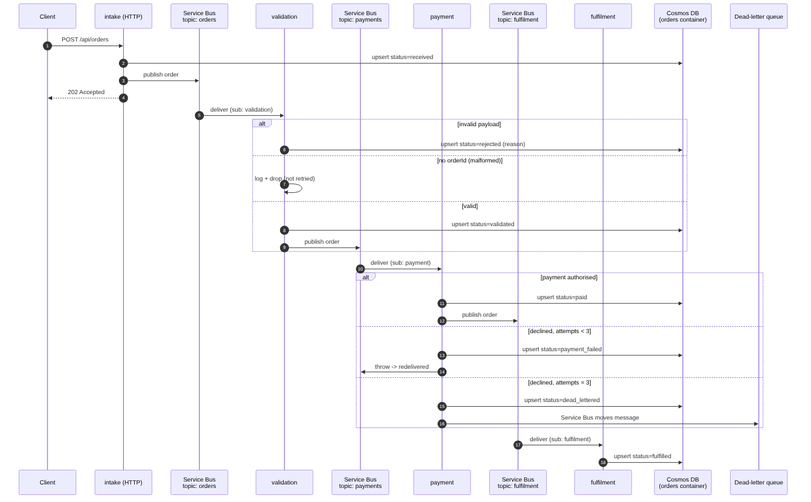
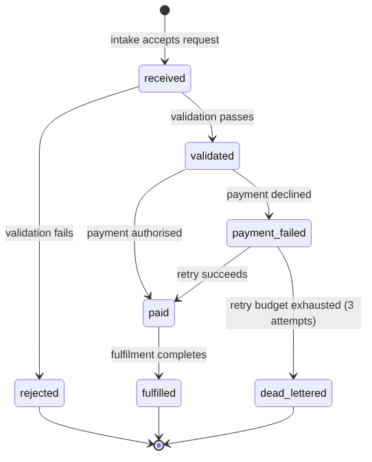

# Architecture

> Diagrams in this document are generated from the `.mmd` source files in [`diagrams/`](diagrams/) with the Mermaid CLI (`mmdc`) — they're renderings of the design, not screenshots of a running system. Nothing in this project is deployed to Azure yet; see [Status](../README.md#status) in the README for what's actually been verified.

## Flow

Every stage writes order state to Cosmos DB (container `orders`, partition key `/orderId`). Source: [`diagrams/message-flow.mmd`](diagrams/message-flow.mmd).

## Order states

| From | To | When |
|---|---|---|
| (none) | `received` | intake accepts a request |
| `received` | `validated` | validation passes |
| `received` | `rejected` | validation fails (reason recorded) |
| `validated` | `paid` | payment authorised |
| `validated` | `payment_failed` | payment declined, will retry |
| `payment_failed` | `paid` | retry succeeds |
| `payment_failed` | `dead_lettered` | retry budget exhausted |
| `paid` | `fulfilled` | fulfilment completes |

Illegal transitions raise an error in every implementation, so a message redelivered after a crash cannot move an order backwards. Source: [`diagrams/state-machine.mmd`](diagrams/state-machine.mmd).

## Failure handling

- **Payment declines** raise an error inside the trigger. Service Bus redelivers the message until `max_delivery_count` (5 by default, see Terraform) is reached, then moves it to the dead-letter queue. The payment stage also stops retrying itself after 3 deliveries and marks the order `dead_lettered`.
- **Invalid orders** are recorded as `rejected` and not retried. They are not errors, so they do not clog the queue.
- **Malformed messages with no `orderId`** (not just a failed validation, but a message that cannot be matched to any order) are logged and dropped rather than retried. There is nothing to key a Cosmos write on, so raising here would make Service Bus redeliver a message that can never succeed. This can't happen in normal operation, since `intake` only publishes orders that already have an `orderId`, but all three handlers guard against it defensively.
- **Duplicate messages** are safe because each write is an upsert keyed by `orderId`, and transitions are checked against the stored state.

## Identity and secrets

No connection strings or keys. Function Apps use a system-assigned managed identity with these roles:

- Service Bus namespace: Azure Service Bus Data Sender and Data Receiver
- Storage account: Storage Blob Data Owner (for the Functions host)
- Cosmos DB account: Cosmos DB Built-in Data Contributor (data plane only; key auth is disabled)

## Implementations

The three implementations share the rules in `contracts/` and must agree on every fixture:

| Language | Core | Functions host | Verified here | Verified in CI |
|---|---|---|---|---|
| Python | `python/order_pipeline/core.py` | `python/function_app.py` (v2 model) | 17 tests pass, lint clean | imports cleanly |
| TypeScript | `typescript/src/core.ts` | `typescript/src/functions.ts` (v4 model) | 17 tests pass | compiles with `tsc` |
| C# | `csharp/OrderPipeline/Core/OrderRules.cs` | `csharp/OrderPipeline.Functions/` (isolated worker) | 15 tests pass | builds against real NuGet |

"Verified here" is what's checked by unit tests against pure logic. "Verified in CI" is the first and only point any of this has touched real network access (NuGet, npm, PyPI) — none of it has run against real Azure resources, triggered by a real message, or served a real HTTP request. See [TEST_RESULTS.md](TEST_RESULTS.md) for the actual captured output.

Python and TypeScript both build the same pipeline; C# core tests cover the same rules. Only one implementation needs to be deployed. Choose it with the Terraform `runtime` variable.

## Dead-letter tooling

`tools/deadletter/` lists and reprocesses dead-lettered messages across all three Service Bus subscriptions (`validation`, `payment`, `fulfilment`) — see its [README](../tools/deadletter/README.md). Its pure logic (summarising a dead-lettered message, deciding whether it's safe to resubmit) has 12 passing unit tests; the actual Service Bus calls have not been run against a live namespace, since none exists yet.

## Known gaps (v1)

- Payment is simulated (`PAYMENT_LIMIT`). No real payment provider.
- No alerting on dead-lettered messages yet — the CLI above is for manual/scripted inspection, not automatic notification.
- Cosmos DB is serverless, single region. Multi-region failover is a separate project.
- Terraform has not been validated against the Azure provider in this environment (the registry was unreachable). Run `terraform validate` and `terraform plan` before first deploy.
- Nothing in this repository has been deployed to Azure or run against real cloud resources. All verification so far is unit tests against pure logic, and (for the Functions hosts) that the code compiles — see [TEST_RESULTS.md](TEST_RESULTS.md).
- **TypeScript's payment-retry delivery count is unverified.** Python and C# both read it off a strongly-typed SDK property (`msg.delivery_count`, `message.DeliveryCount`). The Node.js v4 model exposes it through the generic `context.triggerMetadata` bag instead, whose exact key casing for the Service Bus extension could not be confirmed without a real deployment or docs access. The code checks both `deliveryCount` and `DeliveryCount` as a hedge; if neither matches, this code's own retry counting defaults to 1 every time, but Service Bus's own server-side `max_delivery_count` (Terraform) still dead-letters the message independently either way — so this degrades the detail in the recorded `reason`, not the actual safety guarantee.
